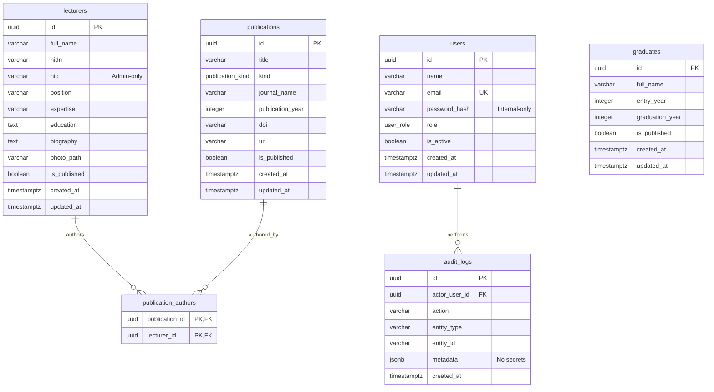

# Database Schema Contract

## 1. Overview & Database Rules
- **RDBMS**: PostgreSQL (v16+)
- **ORM**: Drizzle ORM (`drizzle-orm/pg-core`)
- **Primary Keys**: UUID v4 (`uuid("id").defaultRandom().primaryKey()`) on all entity tables, except `publication_authors` which uses a composite primary/unique key on `(publication_id, lecturer_id)`.
- **Naming Convention**: `snake_case` in PostgreSQL column and table identifiers; `camelCase` in TypeScript Drizzle schema properties. No table prefixing (`pgTable` directly).
- **Timestamps**: ` timestamp("created_at", { withTimezone: true }).defaultNow().notNull()` and `timestamp("updated_at", { withTimezone: true }).defaultNow().$onUpdate(() => new Date()).notNull()`.
- **Migrations**: Managed via `drizzle-kit generate` and `drizzle-kit migrate` in `./drizzle`. Never run destructive `drizzle-kit push` against production databases.
- **No Speculative Tables**: Only the 6 contracted tables (`graduates`, `lecturers`, `publications`, `publication_authors`, `users`, `audit_logs`) and required PostgreSQL enums (`publication_kind`, `user_role`) are defined.

---

## 2. PostgreSQL Enums

### `publication_kind`
- Values: `'JOURNAL'`, `'ARTICLE'`

### `user_role`
- Values: `'SUPER_ADMIN'`, `'ADMIN'`, `'EDITOR'`

---

## 3. Entity Definitions

### 3.1 `graduates`
Stores student graduation records for cohort and graduation statistics.
> **Strict Rule**: `NIM` (Student ID) is strictly prohibited from this table, DTOs, APIs, UI, exports, and logs.

| Column (DB) | Property (TS) | Type | Nullable | Default | Constraints & Validation |
| --- | --- | --- | --- | --- | --- |
| `id` | `id` | `uuid` | No | `gen_random_uuid()` | Primary Key |
| `full_name` | `fullName` | `varchar(255)` | No | — | Non-empty string |
| `entry_year` | `entryYear` | `integer` | No | — | `CHECK (entry_year >= 1950 AND entry_year <= 2100)` |
| `graduation_year` | `graduationYear` | `integer` | No | — | `CHECK (graduation_year >= entry_year AND graduation_year <= 2100)` |
| `is_published` | `isPublished` | `boolean` | No | `false` | Controls public dashboard visibility |
| `created_at` | `createdAt` | `timestamptz` | No | `now()` | — |
| `updated_at` | `updatedAt` | `timestamptz` | No | `now()` | Updated on row modification |

**Indexes**:
- `graduates_is_published_idx` ON `(is_published)`
- `graduates_entry_year_idx` ON `(entry_year)`
- `graduates_graduation_year_idx` ON `(graduation_year)`
- `graduates_published_grad_year_idx` ON `(is_published, graduation_year)`

---

### 3.2 `lecturers`
Stores Informatics laboratory/program lecturer profiles.
> **Strict Rule**: `nip` is strictly confidential to authenticated admin interfaces and must never be exposed in public DTOs. `nidn` may be shown publicly.

| Column (DB) | Property (TS) | Type | Nullable | Default | Constraints & Validation |
| --- | --- | --- | --- | --- | --- |
| `id` | `id` | `uuid` | No | `gen_random_uuid()` | Primary Key |
| `full_name` | `fullName` | `varchar(255)` | No | — | Non-empty string |
| `nidn` | `nidn` | `varchar(64)` | Yes | `null` | Publicly visible when published |
| `nip` | `nip` | `varchar(64)` | Yes | `null` | **Admin-only**; never exposed publicly |
| `position` | `position` | `varchar(255)` | No | — | Academic/functional position |
| `expertise` | `expertise` | `varchar(255)` | No | — | Primary area of expertise |
| `education` | `education` | `text` | Yes | `null` | Educational background |
| `biography` | `biography` | `text` | Yes | `null` | Short academic biography |
| `photo_path` | `photoPath` | `varchar(512)` | Yes | `null` | Relative path or URL to photo |
| `is_published` | `isPublished` | `boolean` | No | `false` | Controls public visibility |
| `created_at` | `createdAt` | `timestamptz` | No | `now()` | — |
| `updated_at` | `updatedAt` | `timestamptz` | No | `now()` | Updated on row modification |

**Indexes**:
- `lecturers_is_published_idx` ON `(is_published)`
- `lecturers_nidn_idx` ON `(nidn)`
- `lecturers_full_name_idx` ON `(full_name)`

---

### 3.3 `publications`
Stores academic journals and articles authored by lecturers.
> **Strict Rule**: Do not duplicate publication rows for multiple co-authors. Author relationships are modeled via `publication_authors`.

| Column (DB) | Property (TS) | Type | Nullable | Default | Constraints & Validation |
| --- | --- | --- | --- | --- | --- |
| `id` | `id` | `uuid` | No | `gen_random_uuid()` | Primary Key |
| `title` | `title` | `varchar(512)` | No | — | Non-empty publication title |
| `kind` | `kind` | `publication_kind` | No | — | Enum: `'JOURNAL' \| 'ARTICLE'` |
| `journal_name` | `journalName` | `varchar(255)` | No | — | Journal, conference, or venue name |
| `publication_year` | `publicationYear` | `integer` | No | — | `CHECK (publication_year >= 1950 AND publication_year <= 2100)` |
| `doi` | `doi` | `varchar(255)` | Yes | `null` | Optional DOI identifier |
| `url` | `url` | `varchar(1024)` | Yes | `null` | Optional external URL |
| `is_published` | `isPublished` | `boolean` | No | `false` | Controls public visibility (requires >=1 published lecturer) |
| `created_at` | `createdAt` | `timestamptz` | No | `now()` | — |
| `updated_at` | `updatedAt` | `timestamptz` | No | `now()` | Updated on row modification |

**Indexes**:
- `publications_is_published_idx` ON `(is_published)`
- `publications_publication_year_idx` ON `(publication_year)`
- `publications_kind_idx` ON `(kind)`
- `publications_published_year_kind_idx` ON `(is_published, publication_year, kind)`

---

### 3.4 `publication_authors`
Many-to-many join table linking `publications` and `lecturers`.
> **Strict Rule**: Never delete lecturer-publication relationships silently. Foreign keys use `ON DELETE RESTRICT` so that attempting to delete a lecturer or publication with active links requires explicit administrative handling.

| Column (DB) | Property (TS) | Type | Nullable | Default | Constraints & Validation |
| --- | --- | --- | --- | --- | --- |
| `publication_id` | `publicationId` | `uuid` | No | — | FK -> `publications.id` (`ON DELETE RESTRICT`) |
| `lecturer_id` | `lecturerId` | `uuid` | No | — | FK -> `lecturers.id` (`ON DELETE RESTRICT`) |

**Constraints & Indexes**:
- Composite Primary Key / Unique Constraint: `publication_authors_pk` ON `(publication_id, lecturer_id)`
- `publication_authors_publication_id_idx` ON `(publication_id)`
- `publication_authors_lecturer_id_idx` ON `(lecturer_id)`

---

### 3.5 `users`
Stores administrative accounts for `/admin/*`.
> **Note**: Authentication uses Credentials (Argon2id) + JWT session strategy backed by this table with mandatory TOTP MFA (`mfa_enabled`, `mfa_secret_encrypted`, `mfa_recovery_codes_hashed`) for `SUPER_ADMIN` and live `session_version` verification. `password_hash`, `mfa_secret_encrypted`, and `mfa_recovery_codes_hashed` must never be exposed in API responses or audit metadata.

| Column (DB) | Property (TS) | Type | Nullable | Default | Constraints & Validation |
| --- | --- | --- | --- | --- | --- |
| `id` | `id` | `uuid` | No | `gen_random_uuid()` | Primary Key |
| `name` | `name` | `varchar(255)` | No | — | Administrator display name |
| `email` | `email` | `varchar(255)` | No | — | Unique (`users_email_unique`) |
| `password_hash` | `passwordHash` | `varchar(255)` | No | — | Argon2id password hash |
| `role` | `role` | `user_role` | No | `'EDITOR'` | Enum: `'SUPER_ADMIN' \| 'ADMIN' \| 'EDITOR'` |
| `is_active` | `isActive` | `boolean` | No | `true` | Inactive users cannot sign in or execute protected procedures |
| `mfa_enabled` | `mfaEnabled` | `boolean` | No | `false` | Mandatory `true` for `SUPER_ADMIN` |
| `mfa_secret_encrypted` | `mfaSecretEncrypted` | `text` | Yes | `null` | AES-256-GCM encrypted Base32 TOTP secret (internal-only) |
| `mfa_recovery_codes_hashed` | `mfaRecoveryCodesHashed` | `jsonb` | No | `'[]'::jsonb` | Argon2id hashed one-time recovery codes (internal-only) |
| `session_version` | `sessionVersion` | `integer` | No | `1` | Incremented on role, password, or active-state change to invalidate stale sessions |
| `created_at` | `createdAt` | `timestamptz` | No | `now()` | — |
| `updated_at` | `updatedAt` | `timestamptz` | No | `now()` | Updated on row modification |

**Indexes & Constraints**:
- Unique constraint `users_email_unique` ON `(email)`
- `users_role_idx` ON `(role)`
- `users_is_active_idx` ON `(is_active)`

---

### 3.6 `audit_logs`
Immutable audit trail recording administrative mutations and security events.

| Column (DB) | Property (TS) | Type | Nullable | Default | Constraints & Validation |
| --- | --- | --- | --- | --- | --- |
| `id` | `id` | `uuid` | No | `gen_random_uuid()` | Primary Key |
| `actor_user_id` | `actorUserId` | `uuid` | Yes | `null` | FK -> `users.id` (`ON DELETE SET NULL`) |
| `action` | `action` | `varchar(128)` | No | — | E.g., `'GRADUATE_CREATE'`, `'LECTURER_PUBLISH'` |
| `entity_type` | `entityType` | `varchar(64)` | No | — | `'GRADUATE' \| 'LECTURER' \| 'PUBLICATION' \| 'USER' \| 'AUTH'` |
| `entity_id` | `entityId` | `varchar(128)` | Yes | `null` | Target record UUID (nullable for bulk/auth events) |
| `metadata` | `metadata` | `jsonb` | No | `'{}'::jsonb` | Contextual diff/summary; **never store secrets, passwords, or NIM** |
| `created_at` | `createdAt` | `timestamptz` | No | `now()` | Immutable creation timestamp |

**Indexes**:
- `audit_logs_actor_user_id_idx` ON `(actor_user_id)`
- `audit_logs_entity_type_idx` ON `(entity_type, entity_id)`
- `audit_logs_created_at_idx` ON `(created_at)`

---

## 4. Entity Relationship Diagram

